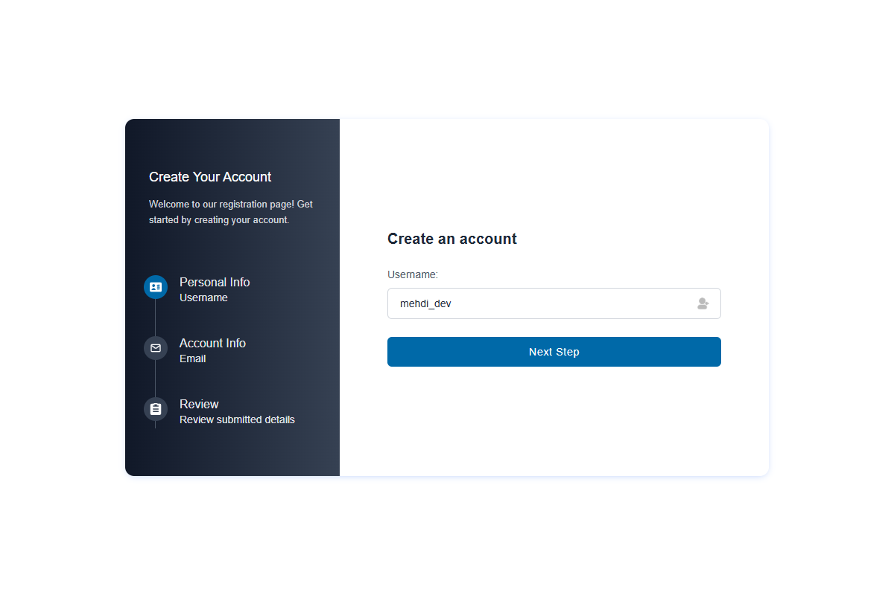
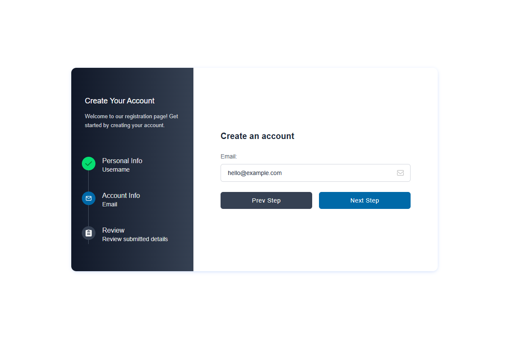
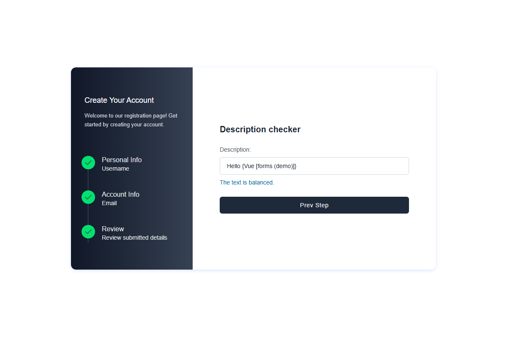

# Vue Multistep Registration

A responsive registration form built with Vue 3, Vite, and Tailwind CSS. This is a frontend project: validation and form state run in the browser, with no registration endpoint or data persistence.


## Getting started

Use Node.js 22 and npm.

```sh
npm ci
npm run dev
```

Open the address printed in the terminal, usually `http://localhost:5173`.

```sh
npm run build     # Create the production build in dist/
npm run preview   # Preview the production build locally
```

## Form flow

1. **Personal information** — enter a username of 4–30 letters, numbers, or underscores.
2. **Account information** — enter an email address with a valid format.
3. **Review** — check the entered details and return to earlier steps to edit them.

Values are retained between steps. Forward navigation validates the required fields, including when using the sidebar. Errors appear beside the relevant input.

| Username | Email |
| --- | --- |
|  |  |

The review screen also links to a separate description exercise. It checks matching and nested `()`, `[]`, and `{}` brackets after a 100 ms typing pause. For example, `{[()]}` is balanced; `([)]` is not.



## Structure

```text
src/
  assets/                 Styles, SVG sprite, and screenshots in imgs/
  components/
    Wizard.vue            Form state, validation, and step navigation
    FormStepper.vue       Step navigation UI; emits selections to the wizard
    Description.vue       Independent bracket-balance exercise
    __tests__/            Cypress component tests
  router/                 Application route configuration
  views/HomeView.vue      Registration page
  App.vue                 Application shell
  main.js                 Vue entry point
```

The wizard owns the registration state and validates navigation. The stepper receives the current step through props and emits selections without changing form data. The description checker manages its own input and clears its pending timer when unmounted. State stays local because this form does not need a shared store.

## Tests

```sh
npm run test:unit          # Headless component tests
npm run test:unit:dev      # Interactive component runner
```

Cypress covers field validation, navigation, review details, and bracket matching. If the Cypress binary is missing, run `npx cypress install` first.

## Deploy to Netlify

1. In Netlify, choose **Add new project → Import an existing project**.
2. Connect GitHub and select `mehdicodespace/vue-multistep-registration`.
3. Select `dev` as the production branch. Leave the base directory empty.
4. Confirm the build command is `npm run build` and the publish directory is `dist`.
5. Deploy the project, then open its Netlify URL and test the form.

`netlify.toml` sets Node.js 22, skips the Cypress binary download during deployment, and includes the SPA fallback. No application environment variables are required. Further pushes to `dev` trigger production deployments.
